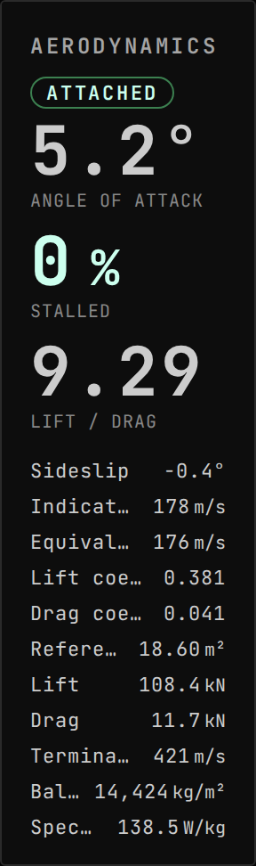
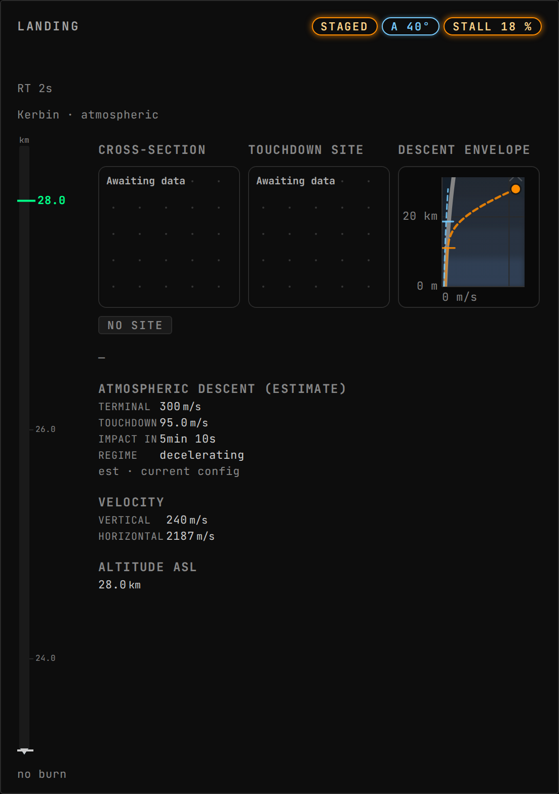

<!-- Generated by `uplink-tools docs` or `uplink-tools page`. Do not edit this file: it is written
     from the registrations, the contract slice and the fixtures. -->

# Aerodynamics

Puts Ferram Aerospace Research's own aerodynamic numbers on the board: angle of attack, sideslip, stall, lift and drag.

An Uplink for [Gonogo](https://ksp-gonogo.github.io/), the mission-control dashboard for Kerbal Space Program that runs in a web browser on any screen.

Built against Ferram Aerospace Research 0.16.1.2.

## Install

Install the Aerodynamics Uplink with CKAN: search for `GonogoFerramAerospaceResearchUplink`, tick it and apply. CKAN also installs Gonogo itself and Ferram Aerospace Research.

Without CKAN, download `GonogoFerramAerospaceResearchUplink.zip` from the releases page, unpack it into your Kerbal Space Program folder so that it lands in `GameData/GonogoFerramAerospaceResearchUplink`, and install Gonogo the same way.

Releases: https://github.com/ksp-gonogo/gonogo-uplinks/releases?q=aero-v

## Widgets

### Aerodynamics

Angle of attack, stall, lift and drag from FAR.

Widget details

| | |
| --- | --- |
| Widget id | `aerodynamics` |
| Reads | `aero.state` |
| Needs | a vessel in flight |
| Default size, in grid units | 4 × 7 |
| Smallest size, in grid units | 4 × 5 |
| Scenes | 4 |

## What it adds to other widgets

| | |
| --- | --- |
|  `aero:descent-envelope` in `plots` |  `aero:descent-envelope-badges` in `landing-status.badges` |

## For developers

Uplink details

| | |
| --- | --- |
| Uplink id | `aero` |
| Wraps | Ferram Aerospace Research (ckan) |
| Version | `0.0.0-development` |
| Built against | contract 51.0, extension API 6.0.0 |

Topics

| Topic | Payload | Delivery | Delay |
| --- | --- | --- | --- |
| `aero.state` | `AeroState` | lossy-latest | delayed |
| `aero.available` | – | lossy-latest | true-now |

Contributions

| Contribution | Into | Computed from | Presence |
| --- | --- | --- | --- |
| `aero:descent-envelope` | `plots` | `aero.state`, `vessel.landing`, `vessel.flight`, `vessel.surface`, `vessel.identity`, `trackingStation.bodies` | only while `aero` |
| `aero:descent-envelope-badges` | `landing-status.badges` | `aero.state` | only while `aero` |

