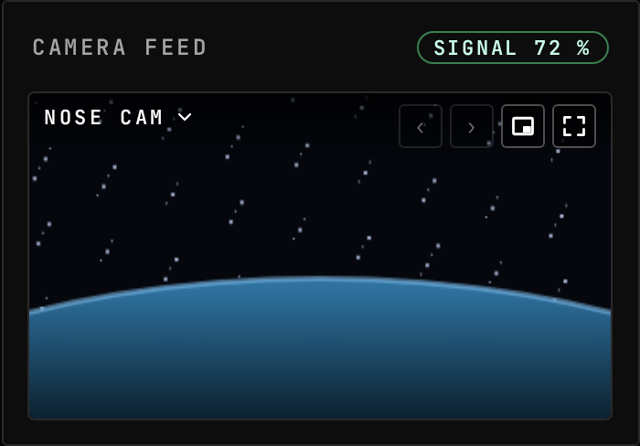
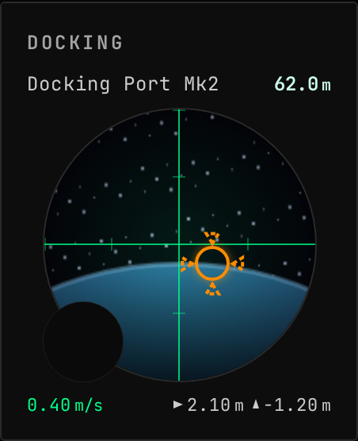

<!-- Generated by `uplink-tools docs` or `uplink-tools page`. Do not edit this file: it is written
     from the registrations, the contract slice and the fixtures. -->

# Kerbcast

Live in-flight camera views from Hullcam VDS parts, with aim and zoom controls, streamed by kerbcast.

An Uplink for [Gonogo](https://ksp-gonogo.github.io/), the mission-control dashboard for Kerbal Space Program that runs in a web browser on any screen.

Built against kerbcast 1.12.1-rc.13.

## Install

Install the Kerbcast Uplink with CKAN: search for `GonogoKerbcastUplink`, tick it and apply. CKAN also installs Gonogo itself and kerbcast.

Without CKAN, download `GonogoKerbcastUplink.zip` from the releases page, unpack it into your Kerbal Space Program folder so that it lands in `GameData/GonogoKerbcastUplink`, and install Gonogo the same way.

Releases: https://github.com/ksp-gonogo/gonogo-uplinks/releases?q=kerbcast-v

## Widgets

### Camera Feed

A live view from a camera on the active craft.

Widget details

| | |
| --- | --- |
| Widget id | `camera-feed` |
| Reads, as dotted paths (a Topic id or a field of its payload) | `vessel.comms`, `comms.link`, `comms.delay` |
| Also reads, if the mod publishes them | `kerbcast.cameras`, `kerbcast.lens.<flightId>` |
| Actions an input can be bound to | Next camera (`next-camera`): Switch to the next available camera, persisting the choice to the widget config (wraps round at the end of the list); Previous camera (`prev-camera`): Switch to the previous available camera (wraps round); Zoom in (`zoom-in`): Held: zooms in, field of view falling. Live, this drives the camera; above the staged delay threshold it turns the staged zoom wheel across its whole range in six seconds and sends nothing until the commit; Zoom out (`zoom-out`): Held: zooms out, field of view rising. Live, this drives the camera; above the staged delay threshold it turns the staged zoom wheel across its whole range in six seconds and sends nothing until the commit; Pan yaw axis (`pan-yaw`): Analog yaw rate, -1..1. Positive = right. Live, this is the camera's pan rate at up to its max pan speed; above the staged delay threshold it turns the staged yaw wheel at up to 30 degrees per second, clamped to the camera's yaw envelope, and sends nothing until the commit; Pan pitch axis (`pan-pitch`): Analog pitch rate, -1..1. Positive = up. Live, this is the camera's pan rate at up to its max pan speed; above the staged delay threshold it turns the staged pitch wheel at up to 30 degrees per second, clamped to the camera's pitch envelope, and sends nothing until the commit. A camera with no pitch envelope does not move either way |
| Slots of its own | `camera-feed.overlay` |
| Default size, in grid units | 9 × 8 |
| Smallest size, in grid units | 7 × 6 |
| Scenes | 12 |

## What it adds to other widgets

| |
| --- |
|  `kerbcast-docking-camera` in `rendezvous.camera` |

## For developers

Uplink details

| | |
| --- | --- |
| Uplink id | `kerbcast` |
| Wraps | kerbcast (ckan) |
| Version | `0.0.0-development` |
| Built against | contract 51.0, extension API 6.0.0 |

Topics

| Topic | Payload | Delivery | Delay |
| --- | --- | --- | --- |
| `kerbcast.cameras` | `KerbcastCameraEntry[]` | lossy-latest | delayed |
| `kerbcast.craftKnowledge` | `KerbcastCraftKnowledgeEntry[]` | lossy-latest | true-now |
| `kerbcast.available` | – | lossy-latest | true-now |

Commands

| Command | Args | Result |
| --- | --- | --- |
| `kerbcast.launchCountdown` | `KerbcastLaunchCountdownArgs` | `CommandResult` |
| `kerbcast.setCommandAim` | `KerbcastSetCommandAimArgs` | `CommandResult` |
| `kerbcast.setFieldOfView` | `KerbcastSetFieldOfViewArgs` | `CommandResult` |
| `kerbcast.setPan` | `KerbcastSetPanArgs` | `CommandResult` |

| Args | Fields |
| --- | --- |
| `KerbcastLaunchCountdownArgs` | `lengthSeconds` s, `remainingSeconds` s, `running` flag |
| `KerbcastSetCommandAimArgs` | `cameraId` id, `lensKey` text, `subjectPersistentId` id |
| `KerbcastSetFieldOfViewArgs` | `cameraId` id, `fieldOfView` °, `lensKey` text |
| `KerbcastSetPanArgs` | `cameraId` id, `lensKey` text, `pitch` °, `yaw` ° |

Augments

| Augment | Into | Reads | Presence | Scenes | Notes |
| --- | --- | --- | --- | --- | --- |
| `kerbcast-crew-avatar` | `crew-status.avatar` | – | only while `kerbcast` | 0 |  |
| `kerbcast-docking-camera` | `rendezvous.camera` | `kerbcast.cameras` | only while `kerbcast` | 1 |  |

