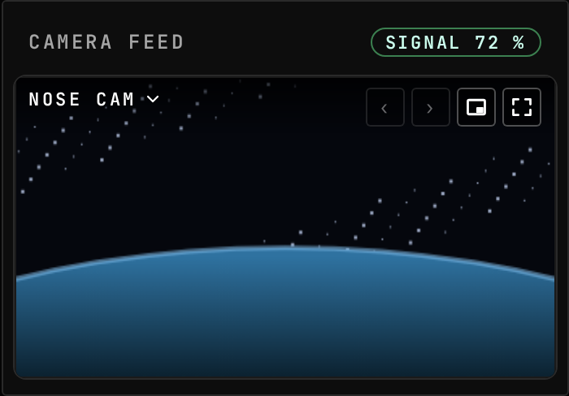
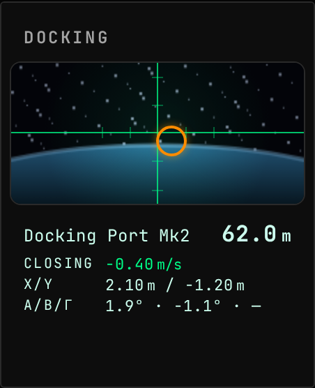

<!-- Generated by `uplink-tools docs` or `uplink-tools page`. Do not edit this file: it is written
     from the registrations, the contract slice and the fixtures. -->

# Kerbcast

Live in-flight camera views from Hullcam VDS parts, with aim and zoom controls, streamed by kerbcast.

| | |
| --- | --- |
| Uplink id | `kerbcast` |
| Version | `1.0.0-rc.4` |
| Wraps | kerbcast 1.11.0-rc.10 (ckan) |
| Built against | contract 49.4, extension API 6.0.0 |

## Install

Install the Kerbcast Uplink with CKAN: search for `GonogoKerbcastUplink`, tick it and apply. CKAN also installs Gonogo itself and kerbcast.

Without CKAN, download `GonogoKerbcastUplink.zip` from the releases page, unpack it into your Kerbal Space Program folder so that it lands in `GameData/GonogoKerbcastUplink`, and install Gonogo the same way.

Releases: https://github.com/ksp-gonogo/gonogo-uplinks/releases?q=kerbcast-v

## Wire

| Topic | Payload | Delivery | Delay |
| --- | --- | --- | --- |
| `kerbcast.cameras` | `KerbcastCameraEntry[]` | lossy-latest | delayed |
| `kerbcast.available` | – | lossy-latest | true-now |

## Commands

| Command | Args | Result |
| --- | --- | --- |
| `kerbcast.setFieldOfView` | `KerbcastSetFieldOfViewArgs` | `CommandResult` |
| `kerbcast.setPan` | `KerbcastSetPanArgs` | `CommandResult` |

| Args | Fields |
| --- | --- |
| `KerbcastSetFieldOfViewArgs` | `cameraId` id, `fieldOfView` ° |
| `KerbcastSetPanArgs` | `cameraId` id, `pitch` °, `yaw` ° |

## Widgets

### Camera Feed

A live view from a camera on the active craft. Pick which camera to watch, step to the next or previous one, and aim and zoom the ones that can.

| | |
| --- | --- |
| Widget id | `camera-feed` |
| Reads, as dotted paths (a Topic id or a field of its payload) | `vessel.comms`, `comms.link`, `comms.delay` |
| Actions an input can be bound to | Next camera (`next-camera`): Switch to the next available camera, persisting the choice to the widget config (wraps round at the end of the list); Previous camera (`prev-camera`): Switch to the previous available camera (wraps round); Zoom in (`zoom-in`): Held: zooms in, field of view falling. Live, this drives the camera; above the staged delay threshold it turns the staged zoom wheel at 30 degrees per second and sends nothing until the commit; Zoom out (`zoom-out`): Held: zooms out, field of view rising. Live, this drives the camera; above the staged delay threshold it turns the staged zoom wheel at 30 degrees per second and sends nothing until the commit; Pan yaw axis (`pan-yaw`): Analog yaw rate, -1..1. Positive = right. Live, this is the camera's pan rate at up to its max pan speed; above the staged delay threshold it turns the staged yaw wheel at up to 30 degrees per second, clamped to the camera's yaw envelope, and sends nothing until the commit; Pan pitch axis (`pan-pitch`): Analog pitch rate, -1..1. Positive = up. Live, this is the camera's pan rate at up to its max pan speed; above the staged delay threshold it turns the staged pitch wheel at up to 30 degrees per second, clamped to the camera's pitch envelope, and sends nothing until the commit. A camera with no pitch envelope does not move either way |
| Slots of its own | `camera-feed.overlay` |
| Default size, in grid units | 9 × 8 |
| Smallest size, in grid units | 7 × 6 |
| Scenes | 3 |

## Augments

| Augment | Into | Reads | Presence | Scenes | Notes |
| --- | --- | --- | --- | --- | --- |
| `kerbcast-crew-avatar` | `crew-status.avatar` | – | only while `kerbcast` | 0 |  |
| `kerbcast-docking-camera` | `rendezvous.camera` | `kerbcast.cameras` | only while `kerbcast` | 1 |  |

