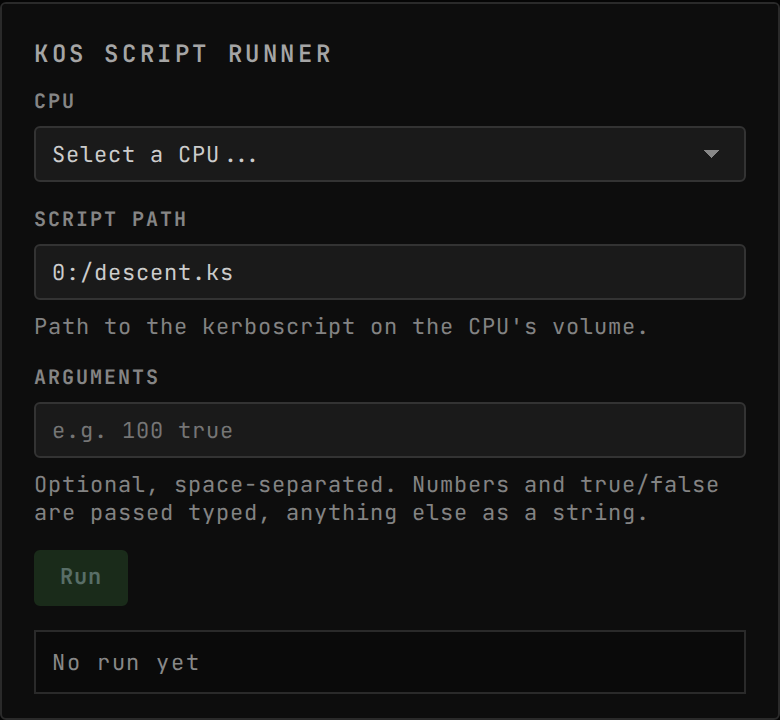
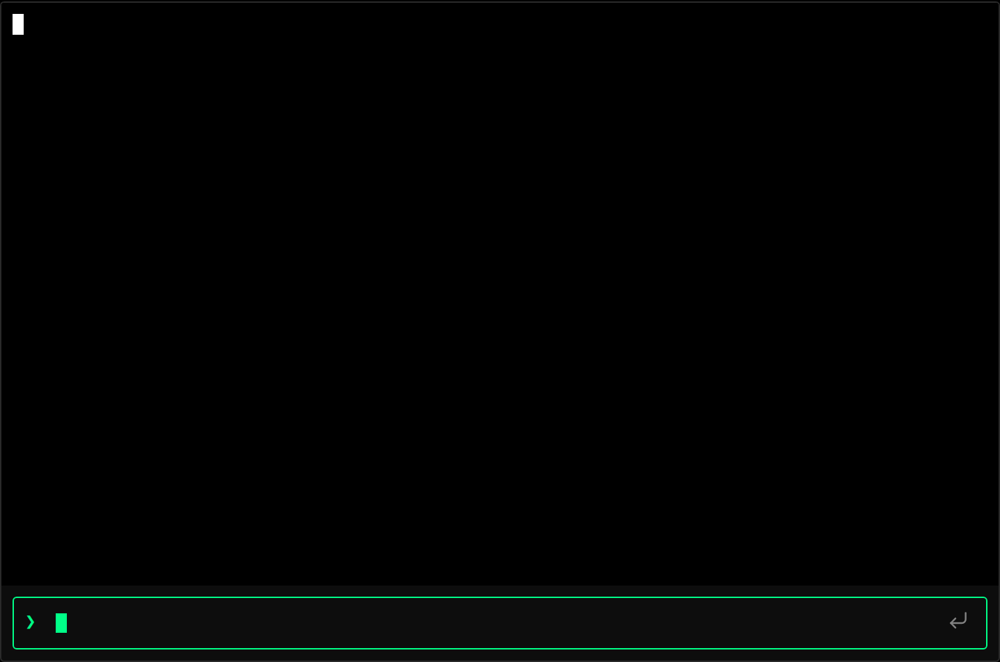

<!-- Generated by `uplink-tools docs` or `uplink-tools page`. Do not edit this file: it is written
     from the registrations, the contract slice and the fixtures. -->

# kOS

Integrates kOS terminals into the dashboard.

An Uplink for [Gonogo](https://ksp-gonogo.github.io/), the mission-control dashboard for Kerbal Space Program that runs in a web browser on any screen.

Built against kOS 1.6.0.1.

## Install

Install the kOS Uplink with CKAN: search for `GonogoKosUplink`, tick it and apply. CKAN also installs Gonogo itself and kOS.

Without CKAN, download `GonogoKosUplink.zip` from the releases page, unpack it into your Kerbal Space Program folder so that it lands in `GameData/GonogoKosUplink`, and install Gonogo the same way.

Releases: https://github.com/ksp-gonogo/gonogo-uplinks/releases?q=kos-v

## Widgets

### kOS Script Trigger

Run a kerboscript on a kOS CPU and see the result.

Widget details

| | |
| --- | --- |
| Widget id | `kos-script-trigger` |
| Reads, as dotted paths (a Topic id or a field of its payload) | `kos.processors` |
| Default size, in grid units | 10 × 9 |
| Smallest size, in grid units | 6 × 7 |
| Scenes | 2 |

### kOS Terminal

The live terminal of a kOS CPU.

Widget details

| | |
| --- | --- |
| Widget id | `kos-terminal` |
| Reads, as dotted paths (a Topic id or a field of its payload) | `kos.processors` |
| Default size, in grid units | 18 × 15 |
| Smallest size, in grid units | 8 × 6 |
| Scenes | 4 |

## For developers

Uplink details

| | |
| --- | --- |
| Uplink id | `kos` |
| Wraps | kOS (ckan) |
| Version | `0.0.0-development` |
| Built against | contract 52.2, extension API 7.0.0 |

Topics

| Topic | Payload | Delivery | Delay |
| --- | --- | --- | --- |
| `kos.processors` | `KosProcessorInfo[]` | lossy-latest | delayed |

| Payload | Fields |
| --- | --- |
| `KosLogEntry` | `coreId` id, `requestId` id, `seq` n/a |
| `KosRunResult` | `coreId` id, `dropped` n/a, `ended` flag, `error` text, `logged` n/a, `requestId` id |
| `KosTerminalFrame` | `chunk` text, `coreId` id, `fullRepaint` flag |

Commands

| Command | Args | Result |
| --- | --- | --- |
| `kos.cancel` | `KosCancelArgs` | `CommandResult` |
| `kos.files.delete` | `KosFilesDeleteArgs` | `CommandResult` |
| `kos.files.list` | `KosFilesListArgs` | `CommandResult` |
| `kos.files.read` | `KosFilesReadArgs` | `CommandResult` |
| `kos.files.rename` | `KosFilesRenameArgs` | `CommandResult` |
| `kos.files.write` | `KosFilesWriteArgs` | `CommandResult` |
| `kos.keystroke` | `KosKeystrokeArgs` | `CommandResult` |
| `kos.run` | `KosRunArgs` | `CommandResult` |
| `kos.terminal.close` | `KosTerminalCloseArgs` | `CommandResult` |
| `kos.terminal.open` | `KosTerminalOpenArgs` | `CommandResult` |
| `kos.terminal.resize` | `KosTerminalResizeArgs` | `CommandResult` |

| Args | Fields |
| --- | --- |
| `KosCancelArgs` | `coreId` id, `requestId` id |
| `KosFilesDeleteArgs` | `coreId` id, `expectedHash` id, `path` text, `requestId` id, `volume` text |
| `KosFilesListArgs` | `coreId` id, `requestId` id, `volume` text |
| `KosFilesReadArgs` | `coreId` id, `path` text, `requestId` id, `volume` text |
| `KosFilesRenameArgs` | `coreId` id, `expectedHash` id, `newPath` text, `path` text, `requestId` id, `volume` text |
| `KosFilesWriteArgs` | `coreId` id, `expectedHash` id, `path` text, `requestId` id, `text` text, `volume` text |
| `KosKeystrokeArgs` | `chars` text, `coreId` id, `leaseToken` id |
| `KosRunArgs` | `copyToLocal` flag, `coreId` id, `path` text, `requestId` id |
| `KosTerminalCloseArgs` | `coreId` id, `leaseToken` id |
| `KosTerminalOpenArgs` | `coreId` id, `leaseToken` id |
| `KosTerminalResizeArgs` | `cols` count, `coreId` id, `leaseToken` id, `rows` count |

Error codes

| Code | Refines | Reads as | Meaning |
| --- | --- | --- | --- |
| `kos.terminalHeld` | `notClearToProceed` | another screen is using this CPU's terminal | Another screen holds this CPU's terminal. A terminal is leased to one screen at a time and never taken from it; it frees when that screen closes it. |
| `kos.cpuBusy` | `notClearToProceed` | the CPU is busy and not at its prompt | The CPU is booting, running a program, or already running a script for another request, so it is not at a prompt that can take one. |
| `kos.scriptNotFound` | `notFound` | there is no script at that path | There is no script at the path a run named, on the volume the path names. |
| `kos.noRoom` | `limitReached` | the CPU's drive has no room for the script | The CPU's own drive has no room for the copy of the script a run asked for. |
| `kos.runUnsupported` | `capabilityMismatch` | this kOS version cannot start a script from here | The installed kOS does not let a script be started from outside its terminal. |
| `kos.badPath` | `range` | that is not a file path this command accepts | The file path is not one a file command accepts: it must be relative to the volume's root, made of letters, digits, `_`, `-` and `.`, with no `..`, no empty segment and no segment starting with `.`. |
| `kos.fileType` | `range` | the file is not a .ks, .ksm, .txt or .json file | Only `.ks`, `.ksm`, `.txt` and `.json` files can be reached by a file command. |
| `kos.notText` | `wrongState` | the file is binary, not text | The file is not UTF-8 text, so it cannot be read or written as text. A compiled `.ksm` file is always refused this way. |
| `kos.fileTooLarge` | `limitReached` | the file is larger than a file command carries | The file, or the text sent to be written, is larger than a file command carries. |
| `kos.driveFull` | `limitReached` | the CPU's drive has no room for the file | The CPU's own drive has no room for the file a write would save. |
| `kos.fileChanged` | `wrongState` | the file has changed since it was read | The file has changed since the hash the command named was read, or has gone. Nothing was written; read the file again before saving over it. |
| `kos.fileExists` | `wrongState` | a file already has that name | A file already has the name a new file or a rename would use. |
| `kos.fileNotFound` | `notFound` | there is no file at that path | There is no file at the path a read, delete or rename named. |
| `kos.notAFile` | `wrongState` | that path is a directory, not a file | The path names a directory, and file commands act on files only. |
| `kos.hashRequired` | `range` | a delete or rename needs the hash the file was read with | A delete or rename names the hash the last read of the file answered with, and this one named none. |

