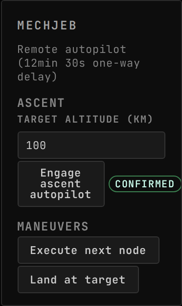

<!-- Generated by `uplink-tools docs` or `uplink-tools page`. Do not edit this file: it is written
     from the registrations, the contract slice and the fixtures. -->

# MechJeb

Flies the vessel from the console: engage MechJeb's ascent autopilot, execute the next node, or land at the selected target, over the delayed command path.

| | |
| --- | --- |
| Uplink id | `mechjeb` |
| Version | `1.0.0-rc.1` |
| Wraps | MechJeb2 2.15.3.0 (ckan) |
| Built against | contract 49.4, extension API 6.0.0 |

## Install

Install the MechJeb Uplink with CKAN: search for `GonogoMechJebUplink`, tick it and apply. CKAN also installs Gonogo itself and MechJeb2.

Without CKAN, download `GonogoMechJebUplink.zip` from the releases page, unpack it into your Kerbal Space Program folder so that it lands in `GameData/GonogoMechJebUplink`, and install Gonogo the same way.

Releases: https://github.com/ksp-gonogo/gonogo-uplinks/releases?q=mechjeb-v

## Wire

## Commands

| Command | Args | Result |
| --- | --- | --- |
| `mechjeb.engageAscentAutopilot` | `MechJebAscentArgs` | `CommandResult` |
| `mechjeb.executeNextNode` | `MechJebNoArgs` | `CommandResult` |
| `mechjeb.landAtTarget` | `MechJebNoArgs` | `CommandResult` |

| Args | Fields |
| --- | --- |
| `MechJebAscentArgs` | `targetAltitudeKm` km |
| `MechJebNoArgs` | – |

## Widgets

### MechJeb

Engage MechJeb's ascent autopilot, execute the next node, or land at the target. Shows the one-way light time each command costs and which commands are still in flight.

| | |
| --- | --- |
| Widget id | `mechjeb` |
| Reads, as dotted paths (a Topic id or a field of its payload) | `comms.delay` |
| Actions an input can be bound to | Engage ascent autopilot (`engage-ascent`): Commands the ascent autopilot to fly to the set target altitude; Execute next node (`execute-node`): Commands execution of the next maneuver node; Land at target (`land-at-target`): Commands an autopilot landing at the selected target |
| Needs | a vessel in flight |
| Default size, in grid units | 5 × 7 |
| Smallest size, in grid units | 4 × 5 |
| Scenes | 3 |

