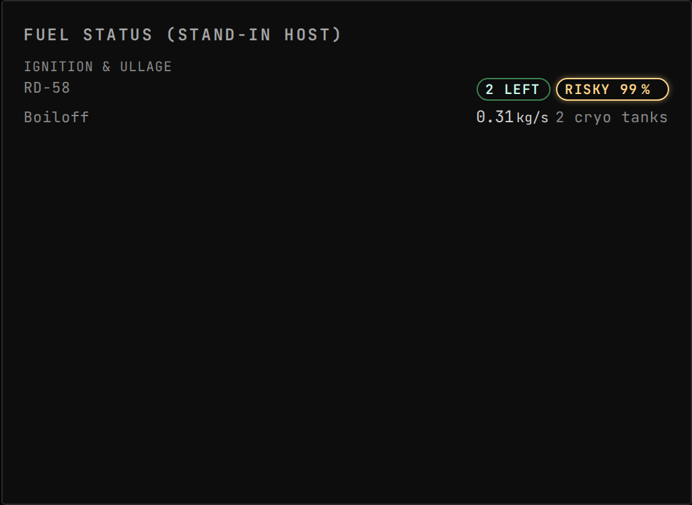

<!-- Generated by `uplink-tools docs` or `uplink-tools page`. Do not edit this file: it is written
     from the registrations, the contract slice and the fixtures. -->

# RealFuels

Reports per-engine RealFuels limits: ignitions remaining, ullage stability and pressure feed, plus cryogenic boiloff.

| | |
| --- | --- |
| Uplink id | `realfuels` |
| Version | `1.0.0-rc.1` |
| Wraps | RealFuels 15.15.0 (ckan) |
| Built against | contract 49.4, extension API 6.0.0 |

## Install

Install the RealFuels Uplink with CKAN: search for `GonogoRealFuelsUplink`, tick it and apply. CKAN also installs Gonogo itself and RealFuels.

Without CKAN, download `GonogoRealFuelsUplink.zip` from the releases page, unpack it into your Kerbal Space Program folder so that it lands in `GameData/GonogoRealFuelsUplink`, and install Gonogo the same way.

Releases: https://github.com/ksp-gonogo/gonogo-uplinks/releases?q=realfuels-v

## Wire

| Topic | Payload | Delivery | Delay |
| --- | --- | --- | --- |
| `realfuels.boiloff` | `RealFuelsBoiloff` | lossy-latest | delayed |
| `realfuels.engines` | `RealFuelsEngines` | lossy-latest | delayed |
| `realfuels.available` | – | lossy-latest | true-now |

| Payload | Fields |
| --- | --- |
| `RealFuelsEngineEntry` | `feedPressureOk` flag, `groundIgnitionOnly` flag, `ignitionProbability` ratio, `ignitionsRemaining` count, `ignitionsUnlimited` flag, `literalZeroIgnitions` flag, `partId` id, `partName` text, `predictedMaximumResiduals` ratio, `pressureFed` flag, `ratedBurnTimeSeconds` s, `ratedContinuousBurnTimeSeconds` s, `ullageModelled` flag, `ullageStability` ratio |

## Augments

| Augment | Into | Reads | Presence | Scenes | Notes |
| --- | --- | --- | --- | --- | --- |
| `realfuels-fuel-status-section` | `fuel-status.sections` | `realfuels.engines`, `realfuels.boiloff` | only while `realfuels` | 3 |  |

